<div align="center">

# Claude, at home on a 1.47″ ESP32‑C6

**A pocket desk toy. Claude's pixel mascot lives in a tiny room: it waters its flower, goes for walks, gets caught in
thunderstorms, plays with a Tiden ball, and runs eight touch and motion games.
All of it runs at 30 fps on a 160 MHz RISC‑V chip without an FPU, in a 3D‑printed case designed as code.**


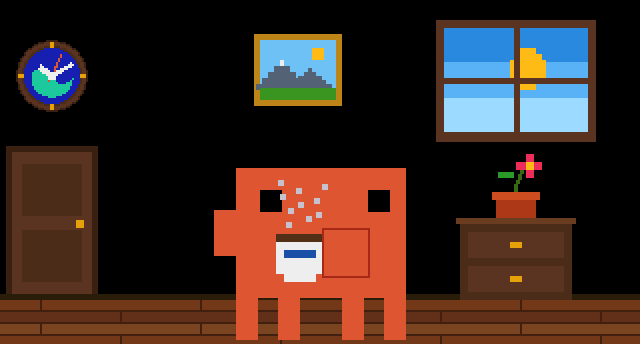

</div>

---

## At a glance

| | |
|---|---|
| **Board** | [Waveshare ESP32‑C6‑Touch‑LCD‑1.47](https://docs.waveshare.com/ESP32-C6-Touch-LCD-1.47): 1.47″ 172×320 IPS (JD9853), capacitive touch (AXS5106L), 6‑axis IMU (QMI8658A) |
| **Engine** | ~6.3k lines of hand-written portable C11 (plus generated animation data), a software renderer into an RGB565 framebuffer, one source tree for the device and the desktop |
| **Performance** | 30 fps. Measured frame time: 19 ms in the home scene, 27.5–32 ms in the heaviest race scenes. ~254 KB heap free |
| **Firmware** | 654 KB image in a 3 MB app partition. Scores are stored in NVS |
| **Testing** | 34 scripted storyboard sessions run the real engine on macOS and render PNG contact sheets and GIFs |
| **Hardware** | 2×AA (USB Li‑ion 1.5 V), power switch, 3 PETG parts printed without supports, board held by snap hooks |

---

## A life of its own

The **SHOW** mode is a little life simulation. A director picks the next activity with weights. It never repeats the
last prop activity, and it waits for every act to end in the base pose so the mascot never jumps between poses.

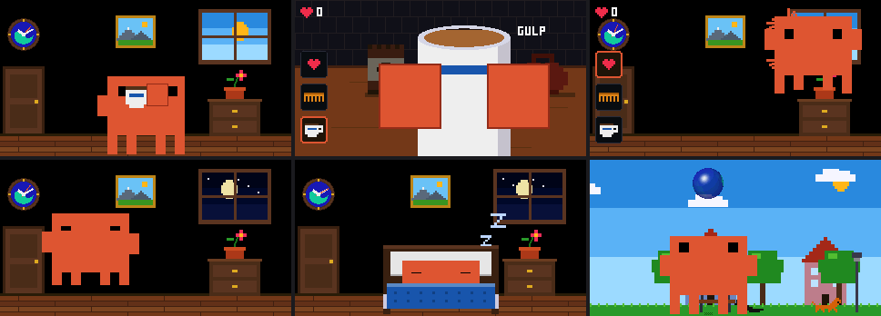

- **Home:**
  - a room with a day/night window;
  - a working analog wall clock made from the Tiden logo;
  - a picture and a cabinet with a flower that wilts in about 5 minutes.
- **Activities:** notebook, a 90s phone call, coffee, a hot dog and a smoothie, watering the flower, sleeping in bed, and the four original animations: walk & jump, gym, flag, confetti.
- **Tap the wilting flower** and Claude goes to water it, right away or after the current act.
- **Walks:** out of the door, round the block (day or night, with dogs) and back in.
- **Shake the board:**
  - at home: Claude is thrown around the room and gets dizzy (spiral eyes, orbiting sparks);
  - on a day walk: an inflatable, see‑through **Tiden ball** drops from the sky, and Claude kicks it up and heads it;
  - on a night walk: a **thunderstorm** starts. Claude runs home, drips onto the floor and shakes it off in one slow, cartoon‑cat shiver.

<table>
<tr>
<td>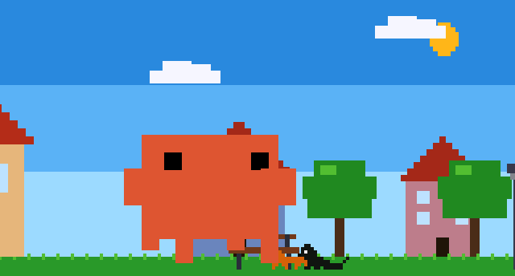</td>
<td>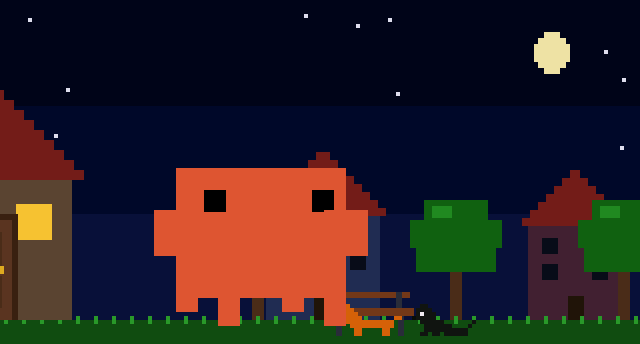</td>
</tr>
<tr>
<td align="center"><sub>The ball is rendered per pixel: logo on both sides, far side seen through the near one, rim, highlight. Integer math in the per-pixel loop</sub></td>
<td align="center"><sub>Lightning, slanted rain, splashes, rain in the window at home. The shiver moves only the mascot's pixels</sub></td>
</tr>
</table>

**PET** is the hands‑on version:
- tap the head, a hand, the feet or the body;
- tickle with three quick taps, or stroke with a slide;
- rest a finger for 0.4 s to pick Claude up, then drag and fling it;
- comb its ruffled fur;
- make coffee in first person: sachet, milk, kettle, then *GULP*.

---

## Eight games

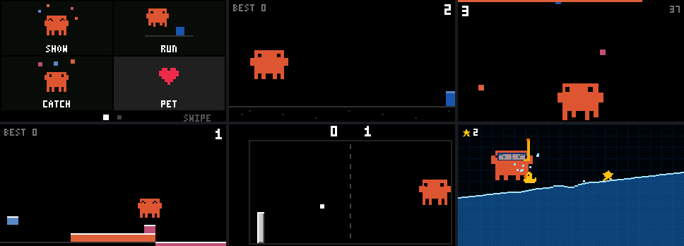

| Game | How you play |
|---|---|
| **RUN** | Tap to jump over obstacles |
| **CATCH** | Drag to catch falling confetti |
| **TOWER** | Tap to drop the next block |
| **PONG** | Drag anywhere. The paddle moves relative to the finger, so your finger never covers it |
| **POOL** | Tilt the board: the water follows real gravity. Steer Claude in mask and snorkel to the stars, tap to jump |
| **RACE** | First person. Hold the board upright and turn it like a steering wheel, hold a finger to brake |

### RACE: a new world every time

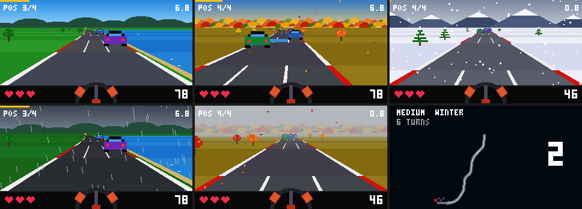

- **Track:** random point‑to‑point layouts every race (straights, sweepers, S‑bends, hairpins). The heading stays within a range so tracks run forward instead of spiralling. The map is drawn during the 3‑2‑1 countdown.
- **Season, never the same twice in a row:**
  - summer, with lakes;
  - an autumn serpentine through red, yellow and green woods;
  - winter, with snowy firs and mountains, and ice instead of puddles.
- **Weather:** sun, rain, fog (distance fading) or snow.
- **Rivals:** each has its own pace, cornering, lane wander, overtaking and mistakes.
- **Hazards by level:**
  - EASY: hay bales;
  - MEDIUM: road works;
  - HARD: rockfalls;
  - levels 2–3: deer and pile‑ups.
- **Damage:** cracks go to the screen edges so they never cover the road. The full shatter shows only on game over.

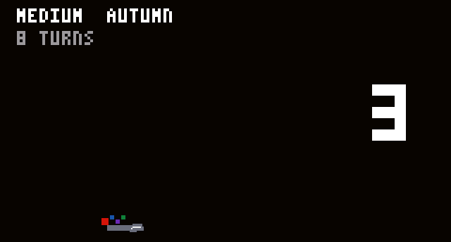

---

## Engineering highlights

### One engine, two targets, storyboard-driven development
The engine (`components/engine/`) has no ESP-IDF dependencies. `tools/host/` compiles **the same C files** on macOS
and drives the real app with scripted touches, shakes, tilts and button presses. Every feature was checked on
deterministic contact sheets before it was flashed. The GIFs on this page are rendered the same way.

```sh
tools/host/build.sh                                   # all sessions -> tools/host/out/*.png
SHOW_FORCE=park ./tools/host/out/scenes out parkstorm # one session, forced act
FRAMES=8800:21400:83 ./tools/host/out/scenes out parkstorm  # frame dump for GIFs
```

### Performance on a chip without an FPU
On the ESP32‑C6 every float operation runs in software. The new race scenery first dropped the race to 21 fps, so it
was profiled **on the device**: a scripted‑touch build logged microseconds per draw section.

| Change | Race frame (autumn) |
|---|---|
| First version with seasons | 46 ms (21 fps) |
| `gfx_color` gamma + saturation: float → fixed point (it was ~12 µs per call); tree crowns from a quarter‑circle table instead of `sqrtf` | 33 ms |
| Objects bucketed by depth in one pass (not 39 passes), curve lookup by cursor, far scenery culled | **27.5 ms (30 fps)** |

### Calibrated on real hardware, not guessed
- **IMU axes** were found from three held poses and checked as a right‑handed triple.
- **Shake thresholds** come from logged data: shakes 2–5 g, handling ~0.5 g, rest 0.01 g.
- **Display color:** the IPS panel washes colors out. Gamma 1.4 and saturation ×1.1 were picked on the device from side‑by‑side variants.
- **Touch:** controls never sit under the finger. Drags are relative with gain, and targets are at least 10 px thick.

### The mascot's animations
`tools/extract_mascot.mjs` reads the published demo's JS bundle **as text** (it never executes it), parses the SVG rects
and contains a hand port of the GSAP timelines. It generates `mascot_data.c`, which `mascot_anim.c` plays on the device.
New poses, props and acts are built on a parametric pose model (`mascot_pose.c`).

---

## Architecture

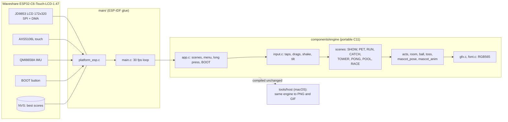

---

## Enclosure, designed as code

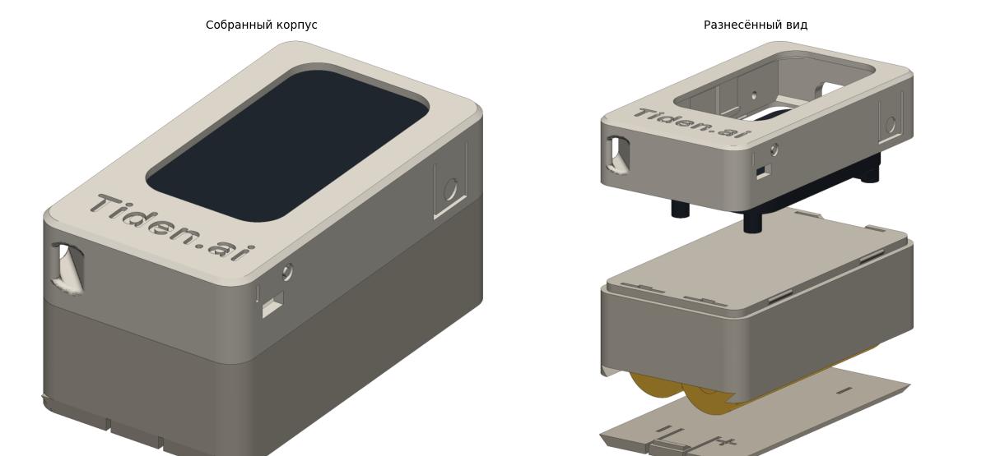

`enclosure/enclosure.py` is a parametric FreeCAD script. One run builds the three parts, checks them against dummy
cells, contact plates and the board, and writes STL (already in print orientation), STEP and drawing sheets with
hidden lines, hatched sections and dimensions.

- **Layout:** board on top, 2×AA below in half‑round cradles, so the cells sit still. The contact plates are held in slots with lips on all sides.
- **Board mount:** no screws. Four snap hooks catch the PCB edge. Their clearance was checked against the official drawing: 1.1 mm to the header pads.
- **Battery lid:** 45° dovetail with a cantilever latch.
- **Side wall:** BOOT pusher on a flexure tab, RST pin hole, slide switch with I/O marks.
- **Lanyard eyelet:** a 45° channel through the corner with rounded window edges, like the strap holes on old phones.
- **Engraved name:** *Tiden.ai*, 0.6 mm deep, ready for paint.
- **Automated checks:** zero overlaps between parts; the cells are blocked at 0.3 mm in every direction; the lid slides out.

<table>
<tr>
<td>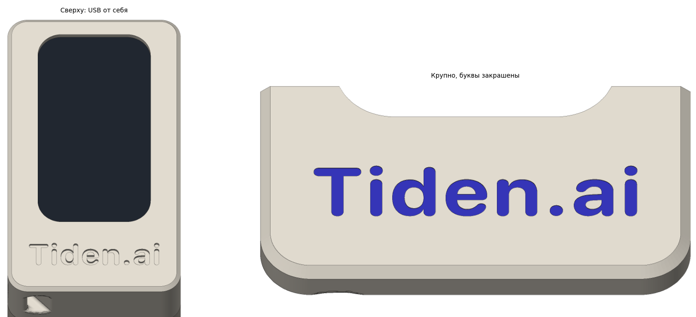</td>
<td>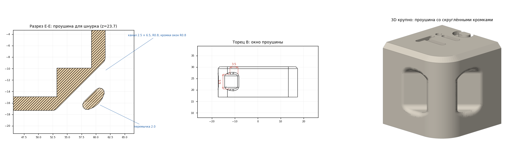</td>
</tr>
</table>

Printing and assembly guide: [`enclosure/README.md`](enclosure/README.md). Wiring and power: [`docs/wiring.md`](docs/wiring.md). Both are in Russian.

---

## Controls

- **BOOT button** (not RST) opens the menu from anywhere; pressed in the menu, it returns to the show.
- **Long press (1.2 s) anywhere** also opens the menu. It is disabled during CATCH, PONG and RACE rounds, while a finger holds Claude in PET, and while the comb is out.
- **Menu:** two pages of four tiles. Swipe sideways to switch pages.
- **In SHOW:** a tap makes Claude look at the tap, wakes it up, or sends it to water the flower.
- **Shake:** dizzy at home, a ball game on day walks, a thunderstorm on night walks. Shakes are ignored during the games.

## Build and flash

```sh
. $IDF_PATH/export.sh            # ESP-IDF 5.5 (tools/idf_env.sh does this on the author's machine)
idf.py build
idf.py -p /dev/cu.usbmodem1101 flash monitor
```

> [!WARNING]
> Plug in USB‑C only with the power switch **OFF**. The onboard charger pushes up to 2 A into whatever is on VBAT, see [`docs/wiring.md`](docs/wiring.md).

Tunables:
- color correction: `GFX_GAMMA` and `GFX_SATURATION` in `gfx.h`;
- backlight: `main/main.c`;
- screen and touch orientation: the flags at the top of `main/platform_esp.c`.

## Repository layout

| Path | What |
|---|---|
| `main/` | ESP-IDF glue: display (SPI DMA), touch, IMU, BOOT button, backlight, battery ADC, NVS, frame loop |
| `components/engine/` | Portable engine: renderer, input, animation player, pose model, scenes, games |
| `components/engine/scene_idle.c` | SHOW director: weighted acts, continuity of position and pose, day/night, the flower |
| `components/engine/acts.c`, `room.c`, `ball.c` | Prop activities, the park (ball game, thunderstorm), the room and clock, the 3D Tiden ball |
| `components/engine/scene_pet.c`, `pet_coffee.c` | PET: gestures, throwing, comb, first‑person coffee |
| `components/engine/scene_race.c` | RACE: track generator, rivals, seasons, weather, hazards |
| `components/esp_lcd_jd9853/`, `components/esp_lcd_touch_axs5106/` | LCD and touch drivers from the Waveshare demo (Apache‑2.0) |
| `tools/host/` | macOS build of the engine: storyboard sessions, contact sheets, frame dumps |
| `tools/extract_mascot.mjs` | Regenerates `mascot_data.c` from the demo bundle (static parse plus a hand port of the timelines) |
| `tools/logo_clock.py` | Rasterises the Tiden logo SVG into the clock dial |
| `enclosure/` | FreeCAD script, STL/STEP, drawing sheets |
| `docs/` | Wiring and power notes, README media |

## How it was built

This project was built in iterations, in pair‑programming sessions with Claude Code. Each iteration closed with a
storyboard review on the host and a check on the real device.
- [`tasks/todo.md`](tasks/todo.md) is the iteration log: what was planned, what was verified and how (in Russian).
- [`lessons.md`](lessons.md) collects the rules learned along the way, from "a fingertip covers 100+ px on a 1.47″ screen" to "keep hot paths integer on a chip without an FPU".

## Credits and licenses

- **Code:** MIT, see [`LICENSE`](LICENSE).
- **Animations:** the four original mascot animations (walk & jump, gym, flag, confetti) are by **Ayotomiwa Wale‑Durojaye**, from his reverse‑engineering of Claude's mascot.
  - Write-up: [Codrops article](https://tympanus.net/codrops/2026/05/05/reverse-engineering-claude-ais-mascot-animations-with-svg-and-gsap/).
  - Original: [demo](https://ayotomcs.me/claude-mascot).
  - `components/engine/mascot_data.c` is generated from his work. It is published here with credit. The MIT license does not cover it.
- **The Claude mascot** is Anthropic's character. This is a personal fan project, not affiliated with Anthropic.
- **LCD and touch drivers:** from the Waveshare demo, based on Espressif's `esp_lcd` components (Apache‑2.0).
- **The Tiden logo and name** belong to [Tiden.ai](https://tiden.ai).
